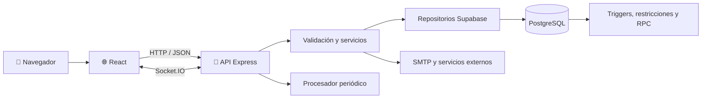

# 🏥 CORA · SAPS Turno

**Gestión de turnos y atención primaria de la salud**  
Salas de Atención Primaria de la Salud · Goya, Corrientes, Argentina

SAPS Turno es una aplicación web con una API propia para organizar la oferta de atención, las reservas y tareas administrativas de las salitas. La interfaz se presenta como **CORA**. Pacientes, profesionales y personal acceden a funciones según su rol y las relaciones vigentes registradas en el sistema.

[Funciones](#funciones) · [Roles](#roles-y-alcance) · [Arquitectura](#arquitectura) · [Inicio local](#inicio-local) · [Documentación](#documentacion)

## 📑 Contenido

- [Funciones](#funciones)
- [Roles y alcance](#roles-y-alcance)
- [Arquitectura](#arquitectura)
- [Tecnologías](#tecnologias)
- [Estructura](#estructura-del-repositorio)
- [Inicio local](#inicio-local)
- [Base de datos y configuración](#base-de-datos-y-configuracion)
- [Documentación](#documentacion)
- [Estado y límites](#estado-y-limites)

<a id="funciones"></a>

## ✨ Funciones

| Área | Capacidades implementadas |
|---|---|
| 🔐 Acceso | Cuentas, inicio de sesión, verificación de correo, recuperación de contraseña e identidad Google para pacientes. |
| 👥 Pacientes | Perfil, cobertura territorial, turnos propios y gestión delegada cuando la vinculación está aprobada y vigente. |
| 🏥 Recursos | Salitas, zonas, barrios, cobertura, profesionales, especialidades y horarios de atención. |
| 🎫 Turnos y agenda | Disponibilidad, reservas, cancelaciones, atención, inasistencias, historial y reprogramación administrativa. |
| 📆 Calendario | Bloqueos y cierres globales o por salita; sincronización de feriados nacionales desde ArgentinaDatos. |
| 🔔 Comunicaciones | Bandeja personal, avisos de turnos y envíos administrativos por los canales configurados. |
| 📊 Gestión | Reportes y exportaciones PDF, Excel y Word; dashboard general para SUPER_ADMIN; auditoría consultable por roles autorizados. |
| 📰 Contenido público | Portada, noticias institucionales y consulta de novedades municipales RSS. |
| 💬 Asistente CORA | Prototipo opcional de orientación funcional, deshabilitado por defecto y no destinado a uso sanitario real. |

La disponibilidad mostrada es informativa: una reserva vuelve a validar las reglas y puede rechazarse si la agenda cambió. Los detalles de cada flujo y sus límites están en la [documentación temática](#-documentación).

<a id="roles-y-alcance"></a>

## 👥 Roles y alcance

| Rol | Alcance general |
|---|---|
| `SUPER_ADMIN` | Administración global, sujeta a las validaciones de cada operación. |
| `ADMIN_SALITA` | Gestión operativa en las salitas asignadas y vigentes. |
| `PROFESIONAL` | Consulta de su agenda y registro de resultados de atención autorizados. |
| `PACIENTE` | Gestión de su perfil y sus turnos; puede actuar por otra persona con autorización vigente. |
| `RECEPCION` | Operaciones habilitadas por API y alcance asignado. En la interfaz tiene acceso limitado a **Configuración → Bloqueos**, no un panel administrativo completo. |

Los controles del servidor son la fuente de autorización; ocultar una opción en la interfaz no concede ni revoca permisos de API.

<a id="arquitectura"></a>

## 🏗️ Arquitectura



El backend agrupa rutas, autenticación/autorización, validadores, controladores, servicios y repositorios. PostgreSQL aporta integridad y operaciones transaccionales para flujos que lo requieren. El proceso de backend inicia HTTP, Socket.IO y tareas periódicas; el correo y otras acciones posteriores a una escritura no forman parte de una transacción distribuida.

La agenda usa fechas civiles de `America/Argentina/Buenos_Aires`. Las garantías de concurrencia dependen de las restricciones, funciones y migraciones SQL instaladas en el entorno. La presencia de un archivo de migración en el repositorio no demuestra que se haya aplicado.

<a id="tecnologias"></a>

## 🧰 Tecnologías

| Componente | Tecnologías principales |
|---|---|
| Interfaz | React, TypeScript, Vite, React Router, Axios, Bootstrap |
| API | Node.js, Express, TypeScript, Zod |
| Persistencia | Supabase y PostgreSQL |
| Identidad y seguridad | Argon2, JOSE, Google Auth Library, Helmet |
| Comunicación | Nodemailer/SMTP, Socket.IO |
| Integraciones opcionales | ArgentinaDatos, RSS municipal, Gemini |
| Exportaciones | PDFKit, ExcelJS, docx |

Las versiones y scripts declarados están en [`backend/package.json`](backend/package.json) y [`frontend/package.json`](frontend/package.json).

<a id="estructura-del-repositorio"></a>

## 📂 Estructura del repositorio

```text
SAPS_Turno/
├── backend/
│   ├── src/       API, servicios, SQL y migraciones
│   └── tests/     Pruebas automatizadas del backend
├── frontend/
│   └── src/       Aplicación React
├── docs/          Documentación funcional y técnica
└── README.md      Presentación y punto de entrada
```

<a id="inicio-local"></a>

## 🚀 Inicio local

Se requieren Node.js y npm compatibles con las dependencias, configuración de backend y frontend, y una base Supabase/PostgreSQL preparada. Los pasos completos y las variables requeridas están en [Instalación y operación](docs/INSTALACION_Y_OPERACION.md); no publiques credenciales ni secretos.

Desde la raíz del repositorio, instala cada aplicación:

```powershell
npm ci --prefix backend
npm ci --prefix frontend
```

Inicia cada proceso en una terminal separada:

```powershell
npm run dev --prefix backend
npm run dev --prefix frontend
```

Comprobaciones disponibles en los paquetes:

```powershell
npm test --prefix backend
npm run typecheck --prefix backend
npm run build --prefix backend
npm run lint --prefix frontend
npm run build --prefix frontend
```

El frontend no declara un script `test`. Los comandos no aplican migraciones; consulta primero la [guía de migraciones](docs/MIGRACIONES.md). En PowerShell puede utilizarse `npm.cmd` si la política local bloquea `npm.ps1`.

<a id="base-de-datos-y-configuracion"></a>

## 🗄️ Base de datos y configuración

La API requiere configuración segura del entorno, incluyendo acceso a Supabase, autenticación y correo. El frontend requiere la URL pública de la API y, si se habilita el acceso Google, su identificador de cliente. La lista vigente, los valores predeterminados y el procedimiento se documentan en [Instalación y operación](docs/INSTALACION_Y_OPERACION.md).

No coloques credenciales en el repositorio ni en variables `VITE_*`: se incorporan al bundle del navegador. La configuración de muestra y los archivos de entorno no sustituyen la validación del entorno de despliegue.

El esquema [`SAPS_Turno_BBDD3_FINAL.sql`](backend/src/BBDD/SAPS_Turno_BBDD3_FINAL.sql) es un reinicio destructivo, no una actualización segura de una base con datos. Las migraciones se aplican manualmente y deben verificarse según el entorno.

<a id="-documentación"></a>
<a id="documentacion"></a>

## 📚 Documentación

El [índice de documentación](docs/README.md) enlaza los 33 documentos y explica sus convenciones.

| Tema | Referencias |
|---|---|
| 🏗️ Arquitectura y código | [Arquitectura](docs/ARQUITECTURA.md) · [Backend](docs/BACKEND.md) · [Frontend](docs/FRONTEND.md) · [Inventario](docs/INVENTARIO_CODIGO.md) |
| 🚀 Operación y datos | [Instalación](docs/INSTALACION_Y_OPERACION.md) · [Migraciones](docs/MIGRACIONES.md) · [Modelo de datos](docs/BASE_DE_DATOS.md) · [Diccionario SQL](docs/DICCIONARIO_SQL.md) |
| 🔌 API y seguridad | [Contrato HTTP](docs/API.md) · [Rutas](docs/API_RUTAS.md) · [Autenticación](docs/AUTENTICACION.md) · [Seguridad y acceso](docs/SEGURIDAD_Y_ACCESO.md) |
| 👥 Pacientes y recursos | [Manual por rol](docs/MANUAL_USUARIO.md) · [Autogestión](docs/PACIENTE_AUTOGESTION.md) · [Personas a cargo](docs/personas-a-cargo.md) · [Recursos y cobertura](docs/RECURSOS_Y_CONFIGURACION.md) |
| 🎫 Turnos y agenda | [Turnos y disponibilidad](docs/TURNOS_Y_DISPONIBILIDAD.md) · [Concurrencia](docs/CONCURRENCIA_AGENDA.md) · [Vigencia profesional-salita](docs/VIGENCIA_PROFESIONAL_SALITA.md) · [Reprogramación asistida](docs/agenda-reprogramacion-asistida.md) · [Ausencias](docs/ausencias-reprogramacion-rapida.md) |
| 📆 Calendario | [Feriados y cierres](docs/feriados-cierres-institucionales.md) · [ArgentinaDatos](docs/argentinadatos-calendario.md) |
| 🔔 Gestión e integraciones | [Notificaciones](docs/NOTIFICACIONES.md) · [Reportes y auditoría](docs/REPORTES_Y_AUDITORIA.md) · [Integraciones](docs/INTEGRACIONES.md) · [Contenido público](docs/CONTENIDO_PUBLICO.md) |
| 💬 Asistente y privacidad | [Asistente CORA](docs/CHATBOT.md) · [Registro de verificación del asistente](docs/CHATBOT_VERIFICACION.md) · [Privacidad del navegador](docs/PRIVACIDAD_NAVEGADOR.md) |

<a id="estado-y-limites"></a>

## ⚠️ Estado y límites

- La documentación describe el código y SQL del repositorio; no certifica el estado de una base, despliegue, proveedor externo o servicio de correo.
- El rol `RECEPCION` tiene más operaciones permitidas en backend que pantallas habilitadas en el frontend.
- El asistente es optativo, se encuentra deshabilitado por defecto y no está destinado a procesar información sanitaria real.
- Los reportes exportables contienen datos que deben gestionarse conforme a las prácticas institucionales de privacidad.

Ante diferencias, verificar las rutas, validadores, servicios y migraciones actuales. El detalle técnico y las limitaciones de cada módulo están en [`docs/`](docs/README.md).
