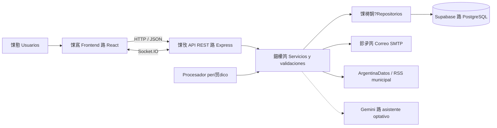

<a id="inicio"></a>

<div align="center">

# 馃┖ CORA 路 SAPS Turno

### Gesti贸n de turnos y atenci贸n primaria de la salud

**Salas de Atenci贸n Primaria de la Salud 路 Goya, Corrientes, Argentina**

Una plataforma para conectar pacientes, profesionales y equipos administrativos.


[Funciones](#funciones) 路 [Roles](#roles) 路 [Instalaci贸n](#instalacion) 路 [Arquitectura](#arquitectura) 路 [Autores](#autores)

</div>

---

## 馃摉 Acerca del proyecto

**SAPS Turno**, presentado en la interfaz como **CORA**, centraliza la organizaci贸n de la atenci贸n en las salitas: pacientes, cobertura territorial, profesionales, especialidades, horarios y reservas.

El sistema incluye una **aplicaci贸n web** y una **API REST**. Cada usuario accede a funciones seg煤n su rol y las relaciones registradas en el sistema, como su salita asignada o su perfil profesional.

| 馃懁 Para pacientes | 馃┖ Para profesionales | 馃彞 Para administraci贸n |
| --- | --- | --- |
| Encontrar atenci贸n disponible y gestionar sus turnos. | Consultar su agenda y registrar el resultado de la atenci贸n. | Organizar recursos, gestionar cuentas y consultar la actividad de las salitas. |

<details>
<summary><strong>馃Л 脥ndice de documentaci贸n</strong></summary>

- [Funciones principales](#funciones)
- [Asistente CORA: prototipo funcional, configuraci贸n y privacidad](docs/CHATBOT.md)
- [Roles y alcance](#roles)
- [C贸mo se utiliza](#uso)
- [Reglas de reservas, sanciones y bloqueos](#reglas)
- [Agenda, reprogramaci贸n y calendario institucional](#agenda)
- [Seguridad, privacidad y l铆mites actuales](#seguridad)
- [Herramientas y tecnolog铆as](#tecnologias)
- [Arquitectura y organizaci贸n](#arquitectura)
- [Instalaci贸n y configuraci贸n](#instalacion)
- [Comandos de desarrollo](#comandos)
- [API y documentaci贸n relacionada](#api)
- [Contribuciones](#contribuciones)
- [Autores y colaboradores](#autores)

</details>

---

<a id="funciones"></a>

## 鉁?Funciones principales

| M贸dulo | Acciones disponibles |
| --- | --- |
| 馃攼 **Acceso y cuentas** | Inicio de sesi贸n, verificaci贸n de correo, recuperaci贸n de contrase帽a, acceso con Google para pacientes y administraci贸n de cuentas seg煤n permisos. |
| 馃懃 **Pacientes y personas a cargo** | Fichas personales, solicitudes de vinculaci贸n, aprobaci贸n administrativa, delegaci贸n de gesti贸n y revocaci贸n de autorizaciones. |
| 馃彞 **Salitas y cobertura** | Gesti贸n de salitas, barrios, zonas y relaciones que determinan la cobertura territorial. |
| 馃┖ **Profesionales** | Registro de profesionales, matr铆cula, especialidades, asignaciones a salitas y cuentas de acceso. |
| 馃棑锔?**Horarios y disponibilidad** | Carga de varios d铆as y franjas, duraci贸n de turnos, cupos, vigencias y bloqueos de agenda. |
| 馃師锔?**Turnos** | Solicitud, consulta, confirmaci贸n, cancelaci贸n, reprogramaci贸n administrativa e historial de cambios. |
| 馃攧 **Reprogramaci贸n asistida** | An谩lisis de turnos afectados, b煤squeda de destinos, propuestas y confirmaci贸n individual por turno con control de versi贸n. |
| 馃彌锔?**Calendario institucional** | Feriados, asuetos y cierres globales o por salita; sincronizaci贸n manual y semanal de feriados nacionales desde ArgentinaDatos. |
| 鈿栵笍 **Sanciones** | Restricciones de reserva por inasistencia, consulta de sanciones y anulaci贸n administrativa seg煤n permisos. |
| 馃敂 **Notificaciones** | Avisos internos, comunicaciones administrativas y env铆os por correo seg煤n configuraci贸n. |
| 馃搳 **Reportes** | Res煤menes de actividad, informaci贸n por especialidad y profesional, agenda diaria y exportaciones en PDF, Excel o Word seg煤n el reporte. |
| 馃搱 **Dashboard general** | Totales de entidades, turnos registrados/programados hoy y actividad reciente para SUPER_ADMIN. |
| 馃摪 **Contenido p煤blico** | P谩gina p煤blica, novedades y administraci贸n de publicaciones. |
| 鈿欙笍 **Configuraci贸n y auditor铆a** | Cat谩logos, par谩metros del sistema y consulta de registros de auditor铆a mediante la API autorizada. |
| 馃挰 **Asistente CORA** | Prototipo optativo de orientaci贸n sobre pantallas y funciones; deshabilitado por defecto, sin acceso a datos del negocio ni ejecuci贸n de operaciones. |

<a id="roles"></a>

## 馃洝锔?Roles y alcance

Los permisos se verifican en el servidor. Una opci贸n visible en la interfaz no reemplaza los controles de acceso de la API.

| Rol | Responsabilidad | Alcance general |
| --- | --- | --- |
| 馃憫 `SUPER_ADMIN` | Administraci贸n general del sistema, salitas, cuentas, cat谩logos, agendas y reportes. | Gesti贸n global, sujeta a las validaciones de cada operaci贸n. |
| 馃彞 `ADMIN_SALITA` | Gesti贸n operativa de pacientes, profesionales, horarios, turnos y comunicaciones. | Salitas autorizadas para su cuenta. |
| 馃┖ `PROFESIONAL` | Consulta de su agenda y registro de atenci贸n o inasistencia. | Informaci贸n vinculada a su perfil y turnos autorizados. |
| 馃懁 `PACIENTE` | Gesti贸n de su perfil, solicitud y cancelaci贸n de turnos, consulta de avisos y solicitudes de vinculaci贸n. | Su cuenta y los pacientes sobre los que tiene una autorizaci贸n aprobada y vigente. |
| 馃Ь `RECEPCION` | Operaciones de atenci贸n administrativa habilitadas en determinadas rutas. | Rol contemplado en la API; no cuenta con un recorrido independiente completo en la interfaz actual. |

> [!NOTE]
> El alcance exacto depende de la ruta, el rol y las asignaciones vigentes. La autorizaci贸n de una operaci贸n no implica acceso a todos los registros de una salita o del sistema.

<a id="uso"></a>

## 馃毝 C贸mo se utiliza

### 馃懁 Recorrido del paciente

1. Registrarse o iniciar sesi贸n y completar las verificaciones requeridas.
2. Completar sus datos personales y revisar su cobertura.
3. Ingresar a **Solicitar turno**.
4. Elegir para qui茅n se solicita el turno 鈥攖itular o persona a cargo autorizada鈥? especialidad y profesional.
5. Seleccionar uno de los **d铆as disponibles** del desplegable y luego un horario.
6. Confirmar la solicitud y consultar el turno desde **Mis turnos**.

En **Personas a cargo** puede solicitarse gestionar los turnos de otra persona o delegar la gesti贸n propia. El parentesco y el env铆o de la solicitud no conceden acceso: la administraci贸n debe verificar identidad, documentaci贸n y autorizaci贸n. La cobertura, sanciones y l铆mites se aplican al paciente que recibe la atenci贸n. Los historiales se consultan por separado. Ver [personas a cargo](docs/personas-a-cargo.md).

### 馃彞 Recorrido administrativo

1. Revisar las salitas, barrios y relaciones de cobertura.
2. Registrar al profesional y asignar sus especialidades y salitas.
3. Configurar los d铆as de atenci贸n, las franjas horarias y la vigencia.
4. Gestionar reservas, cancelaciones y reprogramaciones.
5. Consultar la agenda, los reportes y las comunicaciones del equipo.

La administraci贸n tambi茅n revisa solicitudes de vinculaci贸n y gestiona ausencias y cierres. Si un cambio manual de agenda afecta reservas, debe resolverlas antes de guardar. Los feriados importados tienen un tratamiento espec铆fico explicado en [calendario institucional](#agenda).

Al crear horarios, las asignaciones 煤nicas se seleccionan autom谩ticamente. Cuando hay varias opciones autorizadas, el administrador elige la correspondiente. Un mismo d铆a puede tener m谩s de una franja, por ejemplo ma帽ana y tarde.

### 馃┖ Recorrido del profesional

1. Ingresar con su cuenta vinculada al registro profesional.
2. Consultar su agenda de atenci贸n.
3. Registrar el resultado del turno: **atendido** o **no asisti贸**, seg煤n corresponda.

---

<a id="reglas"></a>

## 馃搮 Reglas de reservas, sanciones y bloqueos

### Ventana semanal

| Momento | Fechas habilitadas para el paciente |
| --- | --- |
| Antes del s谩bado a las 12:00 | Desde el d铆a actual hasta el domingo de esa semana. |
| Desde el s谩bado a las 12:00 | Tambi茅n se habilita la semana siguiente completa. |

- La referencia horaria es **Argentina**, zona `America/Argentina/Buenos_Aires`.
- Se conservan los horarios restantes del fin de semana actual.
- La API verifica la ventana al consultar disponibilidad y al reservar.
- La pantalla actualiza la agenda peri贸dicamente y al recuperar el foco.
- Esta restricci贸n corresponde al autoservicio del paciente; administraci贸n conserva sus operaciones de gesti贸n y reprogramaci贸n.

### Reservas por especialidad

Un paciente no puede mantener **dos turnos abiertos de la misma especialidad**, aunque seleccione profesionales diferentes. La restricci贸n se comprueba en la aplicaci贸n y mediante un 铆ndice 煤nico en la base de datos.

Cuando un turno pasa a un estado que deja de impedir otra reserva 鈥攃omo atendido o cancelado鈥?puede solicitarse uno nuevo, siempre que se cumplan las dem谩s condiciones de disponibilidad y acceso.

### Inasistencias

La migraci贸n de sanciones incorpora una suspensi贸n de **siete d铆as 鈥?68 horas鈥?* desde el registro de la inasistencia:

- Se genera al marcar el turno como **`NO_ASISTIO`**.
- Impide nuevas reservas de **todas las especialidades**.
- La interfaz informa la restricci贸n, su motivo y su vencimiento.
- Al vencer o anularse la sanci贸n, deja de impedir nuevas reservas.
- No cancela autom谩ticamente los turnos que ya estaban reservados.

> [!IMPORTANT]
> La generaci贸n autom谩tica requiere aplicar [`20261020_sancion_global_inasistencia.sql`](backend/src/BBDD/20261020_sancion_global_inasistencia.sql) en la base de datos correspondiente. La presencia del archivo en el repositorio no confirma que la migraci贸n est茅 aplicada.
>
> La duraci贸n actual es fija: **siete d铆as**. La configuraci贸n de una duraci贸n diferente por salita todav铆a no est谩 implementada.

### Bloqueos de cuenta

Una cuenta deshabilitada o temporalmente bloqueada no puede continuar operando con normalidad. Los controles se aplican durante la autenticaci贸n, la renovaci贸n de sesi贸n y las solicitudes protegidas, y la interfaz muestra un aviso modal para los distintos roles.

**Sanci贸n de reservas** y **bloqueo de cuenta** son situaciones distintas: la primera restringe la solicitud de turnos; el segundo restringe el acceso a la cuenta.

### Vigencia de asociaciones profesional-salita

Una asociaci贸n operativa requiere `activo = true`, `fecha_desde <= fecha evaluada` y `fecha_hasta` nula o igual/posterior a esa fecha. Ambas fechas son inclusivas y se almacenan como `DATE`; `fecha_desde` no admite NULL y `fecha_hasta = NULL` significa sin finalizaci贸n definida.

- Disponibilidad y horarios propios eval煤an la fecha consultada.
- Creaci贸n, confirmaci贸n y reprogramaci贸n eval煤an la fecha argentina del turno o del nuevo destino.
- El alcance para crear cuentas profesionales se eval煤a respecto de hoy en Argentina.
- Las consultas administrativas hist贸ricas conservan las relaciones vencidas. El vencimiento de una salita no invalida las otras asignaciones del profesional.
- Acortar una asociaci贸n no cancela ni reprograma autom谩ticamente turnos existentes.

El repositorio reutiliza `getSalitasByProfesional` con una fecha opcional para las consultas operativas. La validaci贸n SQL complementaria se encuentra en [20261109_profesional_salita_vigencia.sql](backend/src/BBDD/20261109_profesional_salita_vigencia.sql).

<a id="agenda"></a>

## 馃棑锔?Agenda, reprogramaci贸n y calendario institucional

### Horarios, cupos y estados

`cupo_maximo_diario` limita los turnos que ocupan agenda por horario de atenci贸n y d铆a argentino; no representa capacidad simult谩nea de un mismo slot. NULL significa sin ese l铆mite diario. La duraci贸n y la finalizaci贸n del turno se obtienen del horario configurado.

| Estados iniciales del cat谩logo | Ocupan agenda |
| --- | --- |
| `SOLICITADO`, `CONFIRMADO`, `EN_ESPERA` | S铆 |
| `ATENDIDO`, `NO_ASISTIO`, `CANCELADO`, `REPROGRAMADO` | No |

Los indicadores se derivan del cat谩logo mediante un trigger. La reprogramaci贸n administrativa actual modifica el mismo turno y conserva su estado operativo; no lo convierte autom谩ticamente al estado final `REPROGRAMADO`.

### Ausencias y reprogramaci贸n asistida

Los bloqueos afectan una salita y una fecha, con profesional y especialidad opcionales. Admiten d铆a completo o franja parcial. El flujo permite analizar afectados, consultar destinos, revisar una propuesta y confirmar cambios. Cada turno se guarda con control de versi贸n y en su propia transacci贸n: una confirmaci贸n de lote puede informar 茅xitos y fallos parciales.

Los bloqueos y cierres manuales rechazan su guardado mientras queden turnos afectados pendientes. La vista de horarios habituales orienta la elecci贸n de fechas; no garantiza lugares libres. M谩s detalles en [agenda asistida](docs/agenda-reprogramacion-asistida.md) y [ausencias y reprogramaci贸n r谩pida](docs/ausencias-reprogramacion-rapida.md).

### Feriados y cierres

Desde **Configuraci贸n 鈫?Feriados y cierres**, SUPER_ADMIN gestiona cierres globales o por salita; ADMIN_SALITA gestiona los de sus salitas y consulta los globales. Los cierres pueden abarcar varias fechas inclusivas, d铆as completos o una franja repetida cada d铆a.

- SUPER_ADMIN puede solicitar **Actualizar feriados nacionales**.
- La sincronizaci贸n intenta el a帽o argentino actual y el siguiente, sin copiar ni inventar fechas.
- La ejecuci贸n autom谩tica corresponde al s谩bado a las **03:00 de Argentina**, en el siguiente ciclo del procesador del backend. Al reiniciar recupera la ejecuci贸n debida.
- Un lease persistente coordina las instancias; si un a帽o no puede consultarse o su respuesta es inv谩lida, se conserva la informaci贸n anterior.
- Los importados son de solo lectura y bloquean nuevas reservas inmediatamente. Los turnos existentes permanecen como afectados hasta que administraci贸n los resuelve; no se mueven autom谩ticamente.
- Las consultas de disponibilidad leen la base SAPS, sin llamar al proveedor externo durante una reserva.

Consultar [cierres institucionales](docs/feriados-cierres-institucionales.md) y [sincronizaci贸n con ArgentinaDatos](docs/argentinadatos-calendario.md), incluidas sus limitaciones sobre fechas que desaparecen o cambian en la fuente.

### Consistencia y concurrencia

La disponibilidad es informativa y puede cambiar antes de reservar. El backend revalida la operaci贸n y PostgreSQL constituye la 煤ltima protecci贸n de la escritura:

- Turnos, horarios, bloqueos y cierres comparten el advisory lock transaccional `pg_advisory_xact_lock(20261103, 1)`.
- Los triggers comprueban cupos, bloqueos y cierres dentro de la transacci贸n. Las RPC de agenda reutilizan el mismo lock.
- Las restricciones de exclusi贸n impiden superposiciones por profesional y por paciente; el 铆ndice 煤nico parcial evita otro turno abierto de la misma especialidad.
- Los intervalos son `[inicio, fin)`: dos turnos que solo comparten un extremo son adyacentes.
- Historial y auditor铆a se registran junto con la escritura; correos y eventos de interfaz se procesan despu茅s.

Estas garant铆as requieren las migraciones y triggers instalados. El lock es global y puede hacer esperar operaciones de salitas diferentes. Las consultas previas realizadas desde TypeScript no forman por s铆 mismas una transacci贸n com煤n.

<a id="seguridad"></a>

## 馃攼 Seguridad, privacidad y l铆mites actuales

La API verifica identidad, rol, alcance y relaciones autorizadas. Las claves de servidor permanecen en el backend; ocultar una opci贸n en React no sustituye la autorizaci贸n. La autenticaci贸n propia y sus flujos se describen en [AUTENTICACION.md](docs/AUTENTICACION.md).

El aviso de privacidad informa sobre datos y almacenamiento del navegador. **Entendido** registra la lectura del aviso, no un consentimiento para tratamientos adicionales. La pol铆tica incluida es un borrador de prueba pendiente de validaci贸n institucional. Ver [privacidad del navegador](docs/PRIVACIDAD_NAVEGADOR.md).

El **Asistente CORA** es un prototipo acad茅mico optativo, no habilitado para uso sanitario real. Orienta sobre funciones: no diagnostica, reserva ni consulta pacientes o agendas. El texto libre se interpreta localmente; al proveedor se env铆an preguntas can贸nicas y documentaci贸n est谩tica autorizada. Su configuraci贸n, l铆mites por proceso y tratamiento de datos est谩n en [CHATBOT.md](docs/CHATBOT.md).

El dashboard distingue entidades activas de asociaciones vigentes y turnos registrados hoy de turnos programados para hoy. Sus conteos son independientes, no una fotograf铆a transaccional 煤nica. Ver [dashboard de SUPER_ADMIN](docs/DASHBOARD_SUPER_ADMIN.md).

---

<a id="tecnologias"></a>

## 馃О Herramientas y tecnolog铆as

| 脕rea | Herramientas | Uso en el proyecto |
| --- | --- | --- |
| Interfaz | React 19 路 TypeScript 路 Vite | Componentes, tipado y construcci贸n de la aplicaci贸n web. |
| Dise帽o | Bootstrap 5 路 Bootstrap Icons 路 CSS | Formularios, navegaci贸n, tablas, iconos y estilos. |
| Navegaci贸n y HTTP | React Router 路 Axios | Rutas de la aplicaci贸n y comunicaci贸n con la API. |
| Servidor | Node.js 路 Express 5 路 TypeScript | API REST y l贸gica de negocio. |
| Datos | Supabase 路 PostgreSQL | Persistencia, relaciones, restricciones y triggers. |
| Validaci贸n | Zod | Validaci贸n de entradas y variables de entorno. |
| Autenticaci贸n | Argon2 路 JOSE 路 Google Auth Library | Contrase帽as, tokens y verificaci贸n de identidad con Google. |
| Correo | Nodemailer 路 SMTP | Verificaci贸n de correo y comunicaciones. |
| Tiempo real | Socket.IO 路 Socket.IO Client | Eventos de cambios de agenda para actualizar la interfaz autenticada. |
| Integraciones | ArgentinaDatos 路 RSS municipal 路 Gemini optativo | Importaci贸n de feriados, lectura de novedades y orientaci贸n funcional del asistente. |
| Documentos | PDFKit 路 ExcelJS 路 docx | Generaci贸n de reportes y exportaciones. |
| Verificaci贸n | Node Test Runner 路 tsx 路 TypeScript 路 Oxlint | Pruebas del backend, comprobaci贸n de tipos y an谩lisis est谩tico del frontend. |
| Middleware | Helmet 路 CORS 路 Morgan | Cabeceras HTTP, acceso entre or铆genes y registro de solicitudes. |

Las versiones declaradas se encuentran en los archivos [`package.json` del backend](backend/package.json) y [del frontend](frontend/package.json).

<a id="arquitectura"></a>

## 馃彈锔?Arquitectura y organizaci贸n



```text
SAPS_Turno/
鈹溾攢鈹€ backend/
鈹?  鈹溾攢鈹€ src/
鈹?  鈹?  鈹溾攢鈹€ BBDD/           Esquema SQL y migraciones
鈹?  鈹?  鈹溾攢鈹€ config/         Configuraci贸n e integraciones
鈹?  鈹?  鈹溾攢鈹€ controllers/    Entrada y salida HTTP
鈹?  鈹?  鈹溾攢鈹€ middlewares/    Autenticaci贸n, permisos y errores
鈹?  鈹?  鈹溾攢鈹€ repositories/   Acceso a datos
鈹?  鈹?  鈹溾攢鈹€ routes/         Rutas de la API
鈹?  鈹?  鈹溾攢鈹€ services/       Reglas de negocio
鈹?  鈹?  鈹溾攢鈹€ validators/     Esquemas de validaci贸n
鈹?  鈹?  鈹溾攢鈹€ types/          Tipos compartidos del backend
鈹?  鈹?  鈹斺攢鈹€ utils/          Utilidades
鈹?  鈹斺攢鈹€ tests/              Pruebas automatizadas
鈹溾攢鈹€ frontend/
鈹?  鈹斺攢鈹€ src/
鈹?      鈹溾攢鈹€ components/     Componentes de interfaz
鈹?      鈹溾攢鈹€ context/        Sesi贸n y estado compartido
鈹?      鈹溾攢鈹€ pages/          Pantallas por m贸dulo
鈹?      鈹溾攢鈹€ routes/         Navegaci贸n y rutas protegidas
鈹?      鈹溾攢鈹€ services/       Clientes de la API
鈹?      鈹溾攢鈹€ styles/         Estilos de la aplicaci贸n
鈹?      鈹溾攢鈹€ types/          Tipos del frontend
鈹?      鈹斺攢鈹€ utils/          Utilidades
鈹溾攢鈹€ docs/                  Documentaci贸n funcional y t茅cnica por m贸dulo
鈹斺攢鈹€ README.md              Presentaci贸n, configuraci贸n y mapa de documentaci贸n
```

---

<a id="instalacion"></a>

## 馃殌 Instalaci贸n y configuraci贸n

### 1. Preparar el entorno

Se necesita Node.js compatible con las versiones fijadas en los archivos de bloqueo, npm, una base de Supabase configurada y credenciales SMTP. El esquema de entorno actual tambi茅n exige `GOOGLE_CLIENT_ID`. Los paquetes no declaran una versi贸n unificada de Node para todo el repositorio: comprobar los requisitos de las dependencias antes de preparar el entorno.

```bash
git clone https://github.com/Arhiell/SAPS_Turno.git
cd SAPS_Turno
npm ci --prefix backend
npm ci --prefix frontend
```

### 2. Configurar el backend

Crear `backend/.env` a partir de [`backend/.env.example`](backend/.env.example). Si el archivo ya existe, conservar sus valores y completar 煤nicamente los faltantes.

La definici贸n que valida los nombres, requisitos y valores predeterminados est谩 en [`backend/src/config/env.ts`](backend/src/config/env.ts).

| Grupo | Variables principales |
| --- | --- |
| Aplicaci贸n | `NODE_ENV`, `PORT`, `FRONTEND_URL` |
| Supabase | `SUPABASE_URL`, `SUPABASE_PUBLISHABLE_KEY`, `SUPABASE_SECRET_KEY`; `SUPABASE_JWKS_URL` es opcional |
| Sesiones | `JWT_ACCESS_SECRET`, `JWT_ACCESS_EXPIRES_MINUTES`, `REFRESH_TOKEN_EXPIRES_DAYS` |
| Control de acceso | `LOGIN_MAX_ATTEMPTS`, `LOGIN_LOCK_MINUTES` |
| Recuperaci贸n y verificaci贸n | `PASSWORD_RECOVERY_MINUTES`, `EMAIL_VERIFICATION_HOURS` |
| Google | `GOOGLE_CLIENT_ID` |
| Correo | `MAIL_HOST`, `MAIL_PORT`, `MAIL_SECURE`, `MAIL_USER`, `MAIL_PASSWORD`, `MAIL_FROM_NAME`, `MAIL_FROM_EMAIL` |
| Asistente optativo | `CHATBOT_ENABLED`, `GEMINI_API_KEY`, `GEMINI_MODEL` |

El archivo de ejemplo puede contener nombres hist贸ricos: usar `env.ts` como referencia para la configuraci贸n vigente. El backend valida su configuraci贸n al iniciar.

El asistente permanece apagado salvo que `CHATBOT_ENABLED=true`. No hace falta una clave Gemini para iniciar los dem谩s m贸dulos. El nombre de modelo configurado no garantiza disponibilidad ni cuota del proveedor; consultar la [configuraci贸n del asistente](docs/CHATBOT.md) antes de habilitarlo.

### 3. Configurar el frontend

Crear `frontend/.env`:

```dotenv
VITE_API_URL=http://localhost:3000/api
VITE_GOOGLE_CLIENT_ID=tu_identificador_de_cliente_google
```

El identificador de Google debe corresponder al configurado en el backend.

> [!WARNING]
> Las variables `VITE_*` se incorporan al c贸digo del navegador. No colocar all铆 claves secretas de Supabase, credenciales SMTP ni secretos JWT. Los archivos `.env` no deben publicarse.

### 4. Preparar la base de datos

El directorio [`backend/src/BBDD`](backend/src/BBDD) contiene el esquema y las migraciones.

- **Instalaci贸n nueva:** revisar el esquema inicial y las migraciones necesarias.
- **Base existente:** aplicar 煤nicamente las migraciones pendientes, respetando sus dependencias.
- Las migraciones se aplican manualmente; los comandos `dev`, `build` y `start` no las ejecutan.

Adem谩s de las migraciones anteriores de autenticaci贸n, correo, notificaciones y contenido, revisar estas dependencias funcionales:

| Orden relativo | Archivo | Funci贸n |
| --- | --- | --- |
| 1 | [20261020_sancion_global_inasistencia.sql](backend/src/BBDD/20261020_sancion_global_inasistencia.sql) | Sanci贸n global autom谩tica por inasistencia. |
| 2 | [20261031_solicitudes_vinculacion.sql](backend/src/BBDD/20261031_solicitudes_vinculacion.sql) | Solicitudes, aprobaci贸n y trazabilidad de personas a cargo. |
| 3 | [20261103_agenda_impacto.sql](backend/src/BBDD/20261103_agenda_impacto.sql) | Impacto, protecci贸n de horarios/bloqueos y serializaci贸n compartida. |
| 4 | [20261103_agenda_escritura.sql](backend/src/BBDD/20261103_agenda_escritura.sql) | RPC de escritura y reprogramaci贸n; requiere la anterior. |
| 5 | [20261107_cierres_calendario.sql](backend/src/BBDD/20261107_cierres_calendario.sql) | Cierres institucionales; requiere las dos migraciones de agenda. |
| 6 | [20261108_argentinadatos.sql](backend/src/BBDD/20261108_argentinadatos.sql) | Importaci贸n y coordinaci贸n persistente de feriados; requiere cierres. |
| 7 | [20261109_profesional_salita_vigencia.sql](backend/src/BBDD/20261109_profesional_salita_vigencia.sql) | Completa la comprobaci贸n de asociaciones en `validar_turno`. |

La tabla no reemplaza el inventario completo de `BBDD`: revisar las cabeceras y dependencias de cada archivo, especialmente las migraciones de notificaciones del mismo d铆a. No todos los scripts est谩n preparados para ejecutarse repetidamente. La presencia de un archivo no confirma su aplicaci贸n en Supabase.

> [!CAUTION]
> El esquema `SAPS_Turno_BBDD3_FINAL.sql` contiene instrucciones de eliminaci贸n de tablas. No utilizarlo como actualizaci贸n de una base con datos que deban conservarse.

### 5. Iniciar la aplicaci贸n

Abrir dos terminales desde la ra铆z del repositorio:

```bash
# Terminal 1 路 API
npm run dev --prefix backend
```

```bash
# Terminal 2 路 Aplicaci贸n web
npm run dev --prefix frontend
```

| Servicio | Direcci贸n de desarrollo |
| --- | --- |
| 馃寪 Frontend | `http://localhost:5173` 鈥?comprobar la direcci贸n informada por Vite |
| 鈿欙笍 API | `http://localhost:3000/api` 鈥?salvo que se cambie `PORT` |
| 馃挌 Estado de la API | `http://localhost:3000/api/health` |

### 6. Consideraciones de ejecuci贸n y despliegue

- `server.ts` inicia la API, Socket.IO y el procesador peri贸dico de notificaciones, que tambi茅n revisa la sincronizaci贸n del calendario. Con el backend apagado no se procesan esas tareas.
- Configurar el alojamiento del frontend para servir las rutas de React y apuntar `VITE_API_URL` a la API correspondiente. Las variables `VITE_*` se resuelven al compilar.
- El proxy del backend debe permitir las conexiones de Socket.IO adem谩s del tr谩fico HTTP de `/api`.
- Configurar `FRONTEND_URL` y el origen autorizado del cliente Google para el entorno destino.
- La consulta de salud no demuestra que todas las migraciones, el correo o los proveedores externos est茅n operativos.
- El limitador del asistente mantiene contadores por proceso; no representa una cuota coordinada entre varias r茅plicas.

<a id="comandos"></a>

## 馃洜锔?Comandos de desarrollo

Ejecutar desde la ra铆z del repositorio:

En PowerShell, si la pol铆tica de ejecuci贸n bloquea `npm.ps1`, utilizar `npm.cmd` con los mismos argumentos. Los comandos siguientes est谩n documentados para ejecuci贸n manual; no implican que las comprobaciones hayan pasado en el estado actual del proyecto.

| Acci贸n | Comando |
| --- | --- |
| Iniciar backend en desarrollo | `npm run dev --prefix backend` |
| Iniciar frontend en desarrollo | `npm run dev --prefix frontend` |
| Comprobar tipos del backend | `npm run typecheck --prefix backend` |
| Ejecutar pruebas del backend | `npm test --prefix backend` |
| Analizar el frontend | `npm run lint --prefix frontend` |
| Compilar backend | `npm run build --prefix backend` |
| Compilar frontend | `npm run build --prefix frontend` |
| Iniciar backend compilado | `npm start --prefix backend` |
| Previsualizar frontend compilado | `npm run preview --prefix frontend` |

<details>
<summary><strong>馃敡 Utilidades administrativas</strong></summary>

| Comando | Prop贸sito |
| --- | --- |
| `npm run check:email --prefix backend` | Ejecutar la utilidad de comprobaci贸n de correo. |
| `npm run seed:superadmin --prefix backend` | Ejecutar la utilidad de creaci贸n de la cuenta superadministradora. |

Revisar la configuraci贸n y los scripts en [`backend/src/scripts`](backend/src/scripts) antes de ejecutarlos. Estas utilidades pueden enviar correos o modificar la base configurada.

</details>

`preview` permite revisar el frontend compilado localmente; no reemplaza la configuraci贸n de alojamiento de producci贸n.

---

<a id="api"></a>

## 馃攲 API y documentaci贸n relacionada

Todas las rutas siguientes utilizan el prefijo **`/api`**. La tabla identifica m贸dulos; cada operaci贸n tiene sus propios m茅todos, par谩metros y permisos.

| Familia de rutas | Responsabilidad |
| --- | --- |
| `/auth`, `/auth/google`, `/auth/email`, `/auth/password` | Sesiones, identidad, correo y recuperaci贸n de acceso. |
| `/users`, `/access-management` | Usuarios y administraci贸n de cuentas. |
| `/patients`, `/tutors` | Pacientes y tutores. |
| `/patients/personas-a-cargo`, `/patients/mis-responsables`, `/patients/solicitudes-vinculacion`, `/tutor-requests` | Gesti贸n delegada y aprobaci贸n administrativa de vinculaciones. |
| `/salitas`, `/barrios`, `/zonas`, `/salita-barrios` | Cat谩logos territoriales y cobertura. |
| `/profesionales`, `/especialidades` | Profesionales, asignaciones y especialidades. |
| `/horarios-atencion`, `/bloqueos-agenda` | Configuraci贸n de la agenda. |
| `/cierres-calendario`, `/cierres-calendario/sincronizacion` | Cierres institucionales, consulta de sincronizaci贸n e importaci贸n manual autorizada. |
| `/disponibilidad`, `/disponibilidad/fechas` | Horarios disponibles y fechas habilitadas para pacientes. |
| `/turnos`, `/sanciones` | Reservas y restricciones. |
| `/turnos/reprogramacion/impacto`, `/turnos/reprogramacion/propuesta`, `/turnos/reprogramacion/disponibilidad`, `/turnos/reprogramacion/confirmar` | Flujo de reprogramaci贸n asistida. |
| `/notificaciones`, `/reportes`, `/auditoria` | Comunicaciones, indicadores y trazabilidad. |
| `/reportes/dashboard` | Resumen general reservado a SUPER_ADMIN. |
| `/configuracion`, `/public`, `/contenido` | Par谩metros, contenido p煤blico y publicaciones. |
| `/chatbot` | Orientaci贸n funcional optativa para roles autorizados. |

### 馃摎 Referencias del repositorio

- [Registro central de rutas](backend/src/routes/index.ts).
- [Navegaci贸n de la aplicaci贸n](frontend/src/routes/AppRoutes.tsx).
- [Configuraci贸n del entorno](backend/src/config/env.ts).
- [Pruebas del backend](backend/tests).
- [Esquema y migraciones SQL](backend/src/BBDD).
- [Migraci贸n de sanci贸n global por inasistencia](backend/src/BBDD/20261020_sancion_global_inasistencia.sql).

| Tema | Documentaci贸n |
| --- | --- |
| Acceso y cuentas | [Autenticaci贸n](docs/AUTENTICACION.md) |
| Autoservicio del paciente | [Perfil, cobertura y reservas](docs/PACIENTE_AUTOGESTION.md) |
| Gesti贸n delegada | [Personas a cargo y solicitudes](docs/personas-a-cargo.md) |
| Cambios de agenda | [Reprogramaci贸n asistida](docs/agenda-reprogramacion-asistida.md) 路 [Ausencias y reprogramaci贸n r谩pida](docs/ausencias-reprogramacion-rapida.md) |
| Calendario institucional | [Feriados y cierres](docs/feriados-cierres-institucionales.md) 路 [ArgentinaDatos](docs/argentinadatos-calendario.md) |
| Comunicaciones | [Notificaciones](docs/NOTIFICACIONES.md) |
| Contenido y m茅tricas | [Contenido p煤blico](docs/CONTENIDO_PUBLICO.md) 路 [Dashboard general](docs/DASHBOARD_SUPER_ADMIN.md) |
| Asistente | [Configuraci贸n y alcance](docs/CHATBOT.md) 路 [Verificaci贸n documentada](docs/CHATBOT_VERIFICACION.md) |
| Privacidad | [Aviso y almacenamiento del navegador](docs/PRIVACIDAD_NAVEGADOR.md) |

Los informes de verificaci贸n describen ejecuciones hist贸ricas, no certifican el estado actual. Ante diferencias, contrastar la documentaci贸n con las rutas, validadores, scripts y migraciones vigentes del repositorio.

<a id="contribuciones"></a>

## 馃 Contribuciones

1. Crear una rama con un nombre que describa el cambio.
2. Mantener la organizaci贸n por m贸dulos y los controles de permisos del servidor.
3. Documentar cualquier cambio de configuraci贸n, API o base de datos.
4. Ejecutar las comprobaciones pertinentes y las pruebas relacionadas.
5. Presentar el cambio con una descripci贸n del problema, la soluci贸n y su verificaci贸n.

Los cambios de base de datos deben incluir una migraci贸n revisable. No incorporar credenciales, informaci贸n personal real ni archivos de entorno al repositorio.

<a id="autores"></a>

## 馃懆鈥嶐煉?Autores y colaboradores

El historial de Git registra contribuciones bajo los siguientes nombres:

| Colaborador | Referencia |
| --- | --- |
| **Arhiell** | [Perfil de GitHub](https://github.com/Arhiell) |
| **Ariel Ayala** | Historial de contribuciones del repositorio |
| **Andres Herrero** | Historial de contribuciones del repositorio |
| **Leonel Fernandez** | Historial de contribuciones del repositorio |

Los nombres se presentan tal como aparecen en Git; distintos nombres pueden corresponder a una misma persona.

[馃摐 Consultar el historial de contribuciones](https://github.com/Arhiell/SAPS_Turno/commits)

### 馃搫 Licencia

El paquete del backend declara **ISC** en su `package.json`. Consultar la documentaci贸n de licencia que acompa帽e cada distribuci贸n; esa declaraci贸n no describe por s铆 sola una licencia unificada de todos los componentes del repositorio.

---

<div align="center">

**馃彞 CORA 路 SAPS Turno**

Organizaci贸n de la atenci贸n primaria 路 Goya, Corrientes

[猬嗭笍 Volver al inicio](#inicio)

</div>
