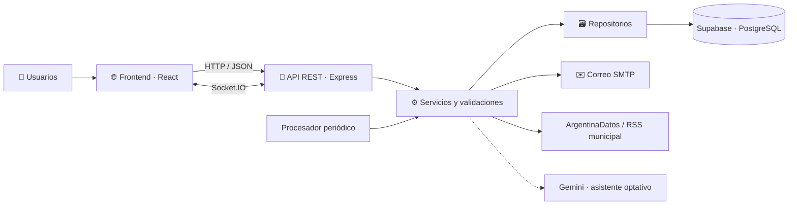

<a id="inicio"></a>

<div align="center">

# 🩺 CORA · SAPS Turno

### Gestión de turnos y atención primaria de la salud

**Salas de Atención Primaria de la Salud · Goya, Corrientes, Argentina**

Una plataforma para conectar pacientes, profesionales y equipos administrativos.


[Funciones](#funciones) · [Roles](#roles) · [Instalación](#instalacion) · [Arquitectura](#arquitectura) · [Autores](#autores)

</div>

---

## 📖 Acerca del proyecto

**SAPS Turno**, presentado en la interfaz como **CORA**, centraliza la organización de la atención en las salitas: pacientes, cobertura territorial, profesionales, especialidades, horarios y reservas.

El sistema incluye una **aplicación web** y una **API REST**. Cada usuario accede a funciones según su rol y las relaciones registradas en el sistema, como su salita asignada o su perfil profesional.

| 👤 Para pacientes | 🩺 Para profesionales | 🏥 Para administración |
| --- | --- | --- |
| Encontrar atención disponible y gestionar sus turnos. | Consultar su agenda y registrar el resultado de la atención. | Organizar recursos, gestionar cuentas y consultar la actividad de las salitas. |

<details>
<summary><strong>🧭 Índice de documentación</strong></summary>

- [Funciones principales](#funciones)
- [Asistente CORA: prototipo funcional, configuración y privacidad](docs/CHATBOT.md)
- [Roles y alcance](#roles)
- [Cómo se utiliza](#uso)
- [Reglas de reservas, sanciones y bloqueos](#reglas)
- [Agenda, reprogramación y calendario institucional](#agenda)
- [Seguridad, privacidad y límites actuales](#seguridad)
- [Herramientas y tecnologías](#tecnologias)
- [Arquitectura y organización](#arquitectura)
- [Instalación y configuración](#instalacion)
- [Comandos de desarrollo](#comandos)
- [API y documentación relacionada](#api)
- [Contribuciones](#contribuciones)
- [Autores y colaboradores](#autores)

</details>

---

<a id="funciones"></a>

## ✨ Funciones principales

| Módulo | Acciones disponibles |
| --- | --- |
| 🔐 **Acceso y cuentas** | Inicio de sesión, verificación de correo, recuperación de contraseña, acceso con Google para pacientes y administración de cuentas según permisos. |
| 👥 **Pacientes y personas a cargo** | Fichas personales, solicitudes de vinculación, aprobación administrativa, delegación de gestión y revocación de autorizaciones. |
| 🏥 **Salitas y cobertura** | Gestión de salitas, barrios, zonas y relaciones que determinan la cobertura territorial. |
| 🩺 **Profesionales** | Registro de profesionales, matrícula, especialidades, asignaciones a salitas y cuentas de acceso. |
| 🗓️ **Horarios y disponibilidad** | Carga de varios días y franjas, duración de turnos, cupos, vigencias y bloqueos de agenda. |
| 🎟️ **Turnos** | Solicitud, consulta, confirmación, cancelación, reprogramación administrativa e historial de cambios. |
| 🔄 **Reprogramación asistida** | Análisis de turnos afectados, búsqueda de destinos, propuestas y confirmación individual por turno con control de versión. |
| 🏛️ **Calendario institucional** | Feriados, asuetos y cierres globales o por salita; sincronización manual y semanal de feriados nacionales desde ArgentinaDatos. |
| ⚖️ **Sanciones** | Restricciones de reserva por inasistencia, consulta de sanciones y anulación administrativa según permisos. |
| 🔔 **Notificaciones** | Avisos internos, comunicaciones administrativas y envíos por correo según configuración. |
| 📊 **Reportes** | Resúmenes de actividad, información por especialidad y profesional, agenda diaria y exportaciones en PDF, Excel o Word según el reporte. |
| 📈 **Dashboard general** | Totales de entidades, turnos registrados/programados hoy y actividad reciente para SUPER_ADMIN. |
| 📰 **Contenido público** | Página pública, novedades y administración de publicaciones. |
| ⚙️ **Configuración y auditoría** | Catálogos, parámetros del sistema y consulta de registros de auditoría mediante la API autorizada. |
| 💬 **Asistente CORA** | Prototipo optativo de orientación sobre pantallas y funciones; deshabilitado por defecto, sin acceso a datos del negocio ni ejecución de operaciones. |

<a id="roles"></a>

## 🛡️ Roles y alcance

Los permisos se verifican en el servidor. Una opción visible en la interfaz no reemplaza los controles de acceso de la API.

| Rol | Responsabilidad | Alcance general |
| --- | --- | --- |
| 👑 `SUPER_ADMIN` | Administración general del sistema, salitas, cuentas, catálogos, agendas y reportes. | Gestión global, sujeta a las validaciones de cada operación. |
| 🏥 `ADMIN_SALITA` | Gestión operativa de pacientes, profesionales, horarios, turnos y comunicaciones. | Salitas autorizadas para su cuenta. |
| 🩺 `PROFESIONAL` | Consulta de su agenda y registro de atención o inasistencia. | Información vinculada a su perfil y turnos autorizados. |
| 👤 `PACIENTE` | Gestión de su perfil, solicitud y cancelación de turnos, consulta de avisos y solicitudes de vinculación. | Su cuenta y los pacientes sobre los que tiene una autorización aprobada y vigente. |
| 🧾 `RECEPCION` | Operaciones de atención administrativa habilitadas en determinadas rutas. | Rol contemplado en la API; no cuenta con un recorrido independiente completo en la interfaz actual. |

> [!NOTE]
> El alcance exacto depende de la ruta, el rol y las asignaciones vigentes. La autorización de una operación no implica acceso a todos los registros de una salita o del sistema.

<a id="uso"></a>

## 🚶 Cómo se utiliza

### 👤 Recorrido del paciente

1. Registrarse o iniciar sesión y completar las verificaciones requeridas.
2. Completar sus datos personales y revisar su cobertura.
3. Ingresar a **Solicitar turno**.
4. Elegir para quién se solicita el turno —titular o persona a cargo autorizada—, especialidad y profesional.
5. Seleccionar uno de los **días disponibles** del desplegable y luego un horario.
6. Confirmar la solicitud y consultar el turno desde **Mis turnos**.

En **Personas a cargo** puede solicitarse gestionar los turnos de otra persona o delegar la gestión propia. El parentesco y el envío de la solicitud no conceden acceso: la administración debe verificar identidad, documentación y autorización. La cobertura, sanciones y límites se aplican al paciente que recibe la atención. Los historiales se consultan por separado. Ver [personas a cargo](docs/personas-a-cargo.md).

### 🏥 Recorrido administrativo

1. Revisar las salitas, barrios y relaciones de cobertura.
2. Registrar al profesional y asignar sus especialidades y salitas.
3. Configurar los días de atención, las franjas horarias y la vigencia.
4. Gestionar reservas, cancelaciones y reprogramaciones.
5. Consultar la agenda, los reportes y las comunicaciones del equipo.

La administración también revisa solicitudes de vinculación y gestiona ausencias y cierres. Si un cambio manual de agenda afecta reservas, debe resolverlas antes de guardar. Los feriados importados tienen un tratamiento específico explicado en [calendario institucional](#agenda).

Al crear horarios, las asignaciones únicas se seleccionan automáticamente. Cuando hay varias opciones autorizadas, el administrador elige la correspondiente. Un mismo día puede tener más de una franja, por ejemplo mañana y tarde.

### 🩺 Recorrido del profesional

1. Ingresar con su cuenta vinculada al registro profesional.
2. Consultar su agenda de atención.
3. Registrar el resultado del turno: **atendido** o **no asistió**, según corresponda.

---

<a id="reglas"></a>

## 📅 Reglas de reservas, sanciones y bloqueos

### Ventana semanal

| Momento | Fechas habilitadas para el paciente |
| --- | --- |
| Antes del sábado a las 12:00 | Desde el día actual hasta el domingo de esa semana. |
| Desde el sábado a las 12:00 | También se habilita la semana siguiente completa. |

- La referencia horaria es **Argentina**, zona `America/Argentina/Buenos_Aires`.
- Se conservan los horarios restantes del fin de semana actual.
- La API verifica la ventana al consultar disponibilidad y al reservar.
- La pantalla actualiza la agenda periódicamente y al recuperar el foco.
- Esta restricción corresponde al autoservicio del paciente; administración conserva sus operaciones de gestión y reprogramación.

### Reservas por especialidad

Un paciente no puede mantener **dos turnos abiertos de la misma especialidad**, aunque seleccione profesionales diferentes. La restricción se comprueba en la aplicación y mediante un índice único en la base de datos.

Cuando un turno pasa a un estado que deja de impedir otra reserva —como atendido o cancelado— puede solicitarse uno nuevo, siempre que se cumplan las demás condiciones de disponibilidad y acceso.

### Inasistencias

La migración de sanciones incorpora una suspensión de **siete días —168 horas—** desde el registro de la inasistencia:

- Se genera al marcar el turno como **`NO_ASISTIO`**.
- Impide nuevas reservas de **todas las especialidades**.
- La interfaz informa la restricción, su motivo y su vencimiento.
- Al vencer o anularse la sanción, deja de impedir nuevas reservas.
- No cancela automáticamente los turnos que ya estaban reservados.

> [!IMPORTANT]
> La generación automática requiere aplicar [`20261020_sancion_global_inasistencia.sql`](backend/src/BBDD/20261020_sancion_global_inasistencia.sql) en la base de datos correspondiente. La presencia del archivo en el repositorio no confirma que la migración esté aplicada.
>
> La duración actual es fija: **siete días**. La configuración de una duración diferente por salita todavía no está implementada.

### Bloqueos de cuenta

Una cuenta deshabilitada o temporalmente bloqueada no puede continuar operando con normalidad. Los controles se aplican durante la autenticación, la renovación de sesión y las solicitudes protegidas, y la interfaz muestra un aviso modal para los distintos roles.

**Sanción de reservas** y **bloqueo de cuenta** son situaciones distintas: la primera restringe la solicitud de turnos; el segundo restringe el acceso a la cuenta.

### Vigencia de asociaciones profesional-salita

Una asociación operativa requiere `activo = true`, `fecha_desde <= fecha evaluada` y `fecha_hasta` nula o igual/posterior a esa fecha. Ambas fechas son inclusivas y se almacenan como `DATE`; `fecha_desde` no admite NULL y `fecha_hasta = NULL` significa sin finalización definida.

- Disponibilidad y horarios propios evalúan la fecha consultada.
- Creación, confirmación y reprogramación evalúan la fecha argentina del turno o del nuevo destino.
- El alcance para crear cuentas profesionales se evalúa respecto de hoy en Argentina.
- Las consultas administrativas históricas conservan las relaciones vencidas. El vencimiento de una salita no invalida las otras asignaciones del profesional.
- Acortar una asociación no cancela ni reprograma automáticamente turnos existentes.

El repositorio reutiliza `getSalitasByProfesional` con una fecha opcional para las consultas operativas. La validación SQL complementaria se encuentra en [20261109_profesional_salita_vigencia.sql](backend/src/BBDD/20261109_profesional_salita_vigencia.sql).

<a id="agenda"></a>

## 🗓️ Agenda, reprogramación y calendario institucional

### Horarios, cupos y estados

`cupo_maximo_diario` limita los turnos que ocupan agenda por horario de atención y día argentino; no representa capacidad simultánea de un mismo slot. NULL significa sin ese límite diario. La duración y la finalización del turno se obtienen del horario configurado.

| Estados iniciales del catálogo | Ocupan agenda |
| --- | --- |
| `SOLICITADO`, `CONFIRMADO`, `EN_ESPERA` | Sí |
| `ATENDIDO`, `NO_ASISTIO`, `CANCELADO`, `REPROGRAMADO` | No |

Los indicadores se derivan del catálogo mediante un trigger. La reprogramación administrativa actual modifica el mismo turno y conserva su estado operativo; no lo convierte automáticamente al estado final `REPROGRAMADO`.

### Ausencias y reprogramación asistida

Los bloqueos afectan una salita y una fecha, con profesional y especialidad opcionales. Admiten día completo o franja parcial. El flujo permite analizar afectados, consultar destinos, revisar una propuesta y confirmar cambios. Cada turno se guarda con control de versión y en su propia transacción: una confirmación de lote puede informar éxitos y fallos parciales.

Los bloqueos y cierres manuales rechazan su guardado mientras queden turnos afectados pendientes. La vista de horarios habituales orienta la elección de fechas; no garantiza lugares libres. Más detalles en [agenda asistida](docs/agenda-reprogramacion-asistida.md) y [ausencias y reprogramación rápida](docs/ausencias-reprogramacion-rapida.md).

### Feriados y cierres

Desde **Configuración → Feriados y cierres**, SUPER_ADMIN gestiona cierres globales o por salita; ADMIN_SALITA gestiona los de sus salitas y consulta los globales. Los cierres pueden abarcar varias fechas inclusivas, días completos o una franja repetida cada día.

- SUPER_ADMIN puede solicitar **Actualizar feriados nacionales**.
- La sincronización intenta el año argentino actual y el siguiente, sin copiar ni inventar fechas.
- La ejecución automática corresponde al sábado a las **03:00 de Argentina**, en el siguiente ciclo del procesador del backend. Al reiniciar recupera la ejecución debida.
- Un lease persistente coordina las instancias; si un año no puede consultarse o su respuesta es inválida, se conserva la información anterior.
- Los importados son de solo lectura y bloquean nuevas reservas inmediatamente. Los turnos existentes permanecen como afectados hasta que administración los resuelve; no se mueven automáticamente.
- Las consultas de disponibilidad leen la base SAPS, sin llamar al proveedor externo durante una reserva.

Consultar [cierres institucionales](docs/feriados-cierres-institucionales.md) y [sincronización con ArgentinaDatos](docs/argentinadatos-calendario.md), incluidas sus limitaciones sobre fechas que desaparecen o cambian en la fuente.

### Consistencia y concurrencia

La disponibilidad es informativa y puede cambiar antes de reservar. El backend revalida la operación y PostgreSQL constituye la última protección de la escritura:

- Turnos, horarios, bloqueos y cierres comparten el advisory lock transaccional `pg_advisory_xact_lock(20261103, 1)`.
- Los triggers comprueban cupos, bloqueos y cierres dentro de la transacción. Las RPC de agenda reutilizan el mismo lock.
- Las restricciones de exclusión impiden superposiciones por profesional y por paciente; el índice único parcial evita otro turno abierto de la misma especialidad.
- Los intervalos son `[inicio, fin)`: dos turnos que solo comparten un extremo son adyacentes.
- Historial y auditoría se registran junto con la escritura; correos y eventos de interfaz se procesan después.

Estas garantías requieren las migraciones y triggers instalados. El lock es global y puede hacer esperar operaciones de salitas diferentes. Las consultas previas realizadas desde TypeScript no forman por sí mismas una transacción común.

<a id="seguridad"></a>

## 🔐 Seguridad, privacidad y límites actuales

La API verifica identidad, rol, alcance y relaciones autorizadas. Las claves de servidor permanecen en el backend; ocultar una opción en React no sustituye la autorización. La autenticación propia y sus flujos se describen en [AUTENTICACION.md](docs/AUTENTICACION.md).

El aviso de privacidad informa sobre datos y almacenamiento del navegador. **Entendido** registra la lectura del aviso, no un consentimiento para tratamientos adicionales. La política incluida es un borrador de prueba pendiente de validación institucional. Ver [privacidad del navegador](docs/PRIVACIDAD_NAVEGADOR.md).

El **Asistente CORA** es un prototipo académico optativo, no habilitado para uso sanitario real. Orienta sobre funciones: no diagnostica, reserva ni consulta pacientes o agendas. El texto libre se interpreta localmente; al proveedor se envían preguntas canónicas y documentación estática autorizada. Su configuración, límites por proceso y tratamiento de datos están en [CHATBOT.md](docs/CHATBOT.md).

El dashboard distingue entidades activas de asociaciones vigentes y turnos registrados hoy de turnos programados para hoy. Sus conteos son independientes, no una fotografía transaccional única. Ver [dashboard de SUPER_ADMIN](docs/DASHBOARD_SUPER_ADMIN.md).

---

<a id="tecnologias"></a>

## 🧰 Herramientas y tecnologías

| Área | Herramientas | Uso en el proyecto |
| --- | --- | --- |
| Interfaz | React 19 · TypeScript · Vite | Componentes, tipado y construcción de la aplicación web. |
| Diseño | Bootstrap 5 · Bootstrap Icons · CSS | Formularios, navegación, tablas, iconos y estilos. |
| Navegación y HTTP | React Router · Axios | Rutas de la aplicación y comunicación con la API. |
| Servidor | Node.js · Express 5 · TypeScript | API REST y lógica de negocio. |
| Datos | Supabase · PostgreSQL | Persistencia, relaciones, restricciones y triggers. |
| Validación | Zod | Validación de entradas y variables de entorno. |
| Autenticación | Argon2 · JOSE · Google Auth Library | Contraseñas, tokens y verificación de identidad con Google. |
| Correo | Nodemailer · SMTP | Verificación de correo y comunicaciones. |
| Tiempo real | Socket.IO · Socket.IO Client | Eventos de cambios de agenda para actualizar la interfaz autenticada. |
| Integraciones | ArgentinaDatos · RSS municipal · Gemini optativo | Importación de feriados, lectura de novedades y orientación funcional del asistente. |
| Documentos | PDFKit · ExcelJS · docx | Generación de reportes y exportaciones. |
| Verificación | Node Test Runner · tsx · TypeScript · Oxlint | Pruebas del backend, comprobación de tipos y análisis estático del frontend. |
| Middleware | Helmet · CORS · Morgan | Cabeceras HTTP, acceso entre orígenes y registro de solicitudes. |

Las versiones declaradas se encuentran en los archivos [`package.json` del backend](backend/package.json) y [del frontend](frontend/package.json).

<a id="arquitectura"></a>

## 🏗️ Arquitectura y organización



```text
SAPS_Turno/
├── backend/
│   ├── src/
│   │   ├── BBDD/           Esquema SQL y migraciones
│   │   ├── config/         Configuración e integraciones
│   │   ├── controllers/    Entrada y salida HTTP
│   │   ├── middlewares/    Autenticación, permisos y errores
│   │   ├── repositories/   Acceso a datos
│   │   ├── routes/         Rutas de la API
│   │   ├── services/       Reglas de negocio
│   │   ├── validators/     Esquemas de validación
│   │   ├── types/          Tipos compartidos del backend
│   │   └── utils/          Utilidades
│   └── tests/              Pruebas automatizadas
├── frontend/
│   └── src/
│       ├── components/     Componentes de interfaz
│       ├── context/        Sesión y estado compartido
│       ├── pages/          Pantallas por módulo
│       ├── routes/         Navegación y rutas protegidas
│       ├── services/       Clientes de la API
│       ├── styles/         Estilos de la aplicación
│       ├── types/          Tipos del frontend
│       └── utils/          Utilidades
├── docs/                  Documentación funcional y técnica por módulo
└── README.md              Presentación, configuración y mapa de documentación
```

---

<a id="instalacion"></a>

## 🚀 Instalación y configuración

### 1. Preparar el entorno

Se necesita Node.js compatible con las versiones fijadas en los archivos de bloqueo, npm, una base de Supabase configurada y credenciales SMTP. El esquema de entorno actual también exige `GOOGLE_CLIENT_ID`. Los paquetes no declaran una versión unificada de Node para todo el repositorio: comprobar los requisitos de las dependencias antes de preparar el entorno.

```bash
git clone https://github.com/Arhiell/SAPS_Turno.git
cd SAPS_Turno
npm ci --prefix backend
npm ci --prefix frontend
```

### 2. Configurar el backend

Crear `backend/.env` a partir de [`backend/.env.example`](backend/.env.example). Si el archivo ya existe, conservar sus valores y completar únicamente los faltantes.

La definición que valida los nombres, requisitos y valores predeterminados está en [`backend/src/config/env.ts`](backend/src/config/env.ts).

| Grupo | Variables principales |
| --- | --- |
| Aplicación | `NODE_ENV`, `PORT`, `FRONTEND_URL` |
| Supabase | `SUPABASE_URL`, `SUPABASE_PUBLISHABLE_KEY`, `SUPABASE_SECRET_KEY`; `SUPABASE_JWKS_URL` es opcional |
| Sesiones | `JWT_ACCESS_SECRET`, `JWT_ACCESS_EXPIRES_MINUTES`, `REFRESH_TOKEN_EXPIRES_DAYS` |
| Control de acceso | `LOGIN_MAX_ATTEMPTS`, `LOGIN_LOCK_MINUTES` |
| Recuperación y verificación | `PASSWORD_RECOVERY_MINUTES`, `EMAIL_VERIFICATION_HOURS` |
| Google | `GOOGLE_CLIENT_ID` |
| Correo | `MAIL_HOST`, `MAIL_PORT`, `MAIL_SECURE`, `MAIL_USER`, `MAIL_PASSWORD`, `MAIL_FROM_NAME`, `MAIL_FROM_EMAIL` |
| Asistente optativo | `CHATBOT_ENABLED`, `GEMINI_API_KEY`, `GEMINI_MODEL` |

El archivo de ejemplo puede contener nombres históricos: usar `env.ts` como referencia para la configuración vigente. El backend valida su configuración al iniciar.

El asistente permanece apagado salvo que `CHATBOT_ENABLED=true`. No hace falta una clave Gemini para iniciar los demás módulos. El nombre de modelo configurado no garantiza disponibilidad ni cuota del proveedor; consultar la [configuración del asistente](docs/CHATBOT.md) antes de habilitarlo.

### 3. Configurar el frontend

Crear `frontend/.env`:

```dotenv
VITE_API_URL=http://localhost:3000/api
VITE_GOOGLE_CLIENT_ID=tu_identificador_de_cliente_google
```

El identificador de Google debe corresponder al configurado en el backend.

> [!WARNING]
> Las variables `VITE_*` se incorporan al código del navegador. No colocar allí claves secretas de Supabase, credenciales SMTP ni secretos JWT. Los archivos `.env` no deben publicarse.

### 4. Preparar la base de datos

El directorio [`backend/src/BBDD`](backend/src/BBDD) contiene el esquema y las migraciones.

- **Instalación nueva:** revisar el esquema inicial y las migraciones necesarias.
- **Base existente:** aplicar únicamente las migraciones pendientes, respetando sus dependencias.
- Las migraciones se aplican manualmente; los comandos `dev`, `build` y `start` no las ejecutan.

Además de las migraciones anteriores de autenticación, correo, notificaciones y contenido, revisar estas dependencias funcionales:

| Orden relativo | Archivo | Función |
| --- | --- | --- |
| 1 | [20261020_sancion_global_inasistencia.sql](backend/src/BBDD/20261020_sancion_global_inasistencia.sql) | Sanción global automática por inasistencia. |
| 2 | [20261031_solicitudes_vinculacion.sql](backend/src/BBDD/20261031_solicitudes_vinculacion.sql) | Solicitudes, aprobación y trazabilidad de personas a cargo. |
| 3 | [20261103_agenda_impacto.sql](backend/src/BBDD/20261103_agenda_impacto.sql) | Impacto, protección de horarios/bloqueos y serialización compartida. |
| 4 | [20261103_agenda_escritura.sql](backend/src/BBDD/20261103_agenda_escritura.sql) | RPC de escritura y reprogramación; requiere la anterior. |
| 5 | [20261107_cierres_calendario.sql](backend/src/BBDD/20261107_cierres_calendario.sql) | Cierres institucionales; requiere las dos migraciones de agenda. |
| 6 | [20261108_argentinadatos.sql](backend/src/BBDD/20261108_argentinadatos.sql) | Importación y coordinación persistente de feriados; requiere cierres. |
| 7 | [20261109_profesional_salita_vigencia.sql](backend/src/BBDD/20261109_profesional_salita_vigencia.sql) | Completa la comprobación de asociaciones en `validar_turno`. |

La tabla no reemplaza el inventario completo de `BBDD`: revisar las cabeceras y dependencias de cada archivo, especialmente las migraciones de notificaciones del mismo día. No todos los scripts están preparados para ejecutarse repetidamente. La presencia de un archivo no confirma su aplicación en Supabase.

> [!CAUTION]
> El esquema `SAPS_Turno_BBDD3_FINAL.sql` contiene instrucciones de eliminación de tablas. No utilizarlo como actualización de una base con datos que deban conservarse.

### 5. Iniciar la aplicación

Abrir dos terminales desde la raíz del repositorio:

```bash
# Terminal 1 · API
npm run dev --prefix backend
```

```bash
# Terminal 2 · Aplicación web
npm run dev --prefix frontend
```

| Servicio | Dirección de desarrollo |
| --- | --- |
| 🌐 Frontend | `http://localhost:5173` — comprobar la dirección informada por Vite |
| ⚙️ API | `http://localhost:3000/api` — salvo que se cambie `PORT` |
| 💚 Estado de la API | `http://localhost:3000/api/health` |

### 6. Consideraciones de ejecución y despliegue

- `server.ts` inicia la API, Socket.IO y el procesador periódico de notificaciones, que también revisa la sincronización del calendario. Con el backend apagado no se procesan esas tareas.
- Configurar el alojamiento del frontend para servir las rutas de React y apuntar `VITE_API_URL` a la API correspondiente. Las variables `VITE_*` se resuelven al compilar.
- El proxy del backend debe permitir las conexiones de Socket.IO además del tráfico HTTP de `/api`.
- Configurar `FRONTEND_URL` y el origen autorizado del cliente Google para el entorno destino.
- La consulta de salud no demuestra que todas las migraciones, el correo o los proveedores externos estén operativos.
- El limitador del asistente mantiene contadores por proceso; no representa una cuota coordinada entre varias réplicas.

<a id="comandos"></a>

## 🛠️ Comandos de desarrollo

Ejecutar desde la raíz del repositorio:

En PowerShell, si la política de ejecución bloquea `npm.ps1`, utilizar `npm.cmd` con los mismos argumentos. Los comandos siguientes están documentados para ejecución manual; no implican que las comprobaciones hayan pasado en el estado actual del proyecto.

| Acción | Comando |
| --- | --- |
| Iniciar backend en desarrollo | `npm run dev --prefix backend` |
| Iniciar frontend en desarrollo | `npm run dev --prefix frontend` |
| Comprobar tipos del backend | `npm run typecheck --prefix backend` |
| Ejecutar pruebas del backend | `npm test --prefix backend` |
| Analizar el frontend | `npm run lint --prefix frontend` |
| Compilar backend | `npm run build --prefix backend` |
| Compilar frontend | `npm run build --prefix frontend` |
| Iniciar backend compilado | `npm start --prefix backend` |
| Previsualizar frontend compilado | `npm run preview --prefix frontend` |

<details>
<summary><strong>🔧 Utilidades administrativas</strong></summary>

| Comando | Propósito |
| --- | --- |
| `npm run check:email --prefix backend` | Ejecutar la utilidad de comprobación de correo. |
| `npm run seed:superadmin --prefix backend` | Ejecutar la utilidad de creación de la cuenta superadministradora. |

Revisar la configuración y los scripts en [`backend/src/scripts`](backend/src/scripts) antes de ejecutarlos. Estas utilidades pueden enviar correos o modificar la base configurada.

</details>

`preview` permite revisar el frontend compilado localmente; no reemplaza la configuración de alojamiento de producción.

---

<a id="api"></a>

## 🔌 API y documentación relacionada

Todas las rutas siguientes utilizan el prefijo **`/api`**. La tabla identifica módulos; cada operación tiene sus propios métodos, parámetros y permisos.

| Familia de rutas | Responsabilidad |
| --- | --- |
| `/auth`, `/auth/google`, `/auth/email`, `/auth/password` | Sesiones, identidad, correo y recuperación de acceso. |
| `/users`, `/access-management` | Usuarios y administración de cuentas. |
| `/patients`, `/tutors` | Pacientes y tutores. |
| `/patients/personas-a-cargo`, `/patients/mis-responsables`, `/patients/solicitudes-vinculacion`, `/tutor-requests` | Gestión delegada y aprobación administrativa de vinculaciones. |
| `/salitas`, `/barrios`, `/zonas`, `/salita-barrios` | Catálogos territoriales y cobertura. |
| `/profesionales`, `/especialidades` | Profesionales, asignaciones y especialidades. |
| `/horarios-atencion`, `/bloqueos-agenda` | Configuración de la agenda. |
| `/cierres-calendario`, `/cierres-calendario/sincronizacion` | Cierres institucionales, consulta de sincronización e importación manual autorizada. |
| `/disponibilidad`, `/disponibilidad/fechas` | Horarios disponibles y fechas habilitadas para pacientes. |
| `/turnos`, `/sanciones` | Reservas y restricciones. |
| `/turnos/reprogramacion/impacto`, `/turnos/reprogramacion/propuesta`, `/turnos/reprogramacion/disponibilidad`, `/turnos/reprogramacion/confirmar` | Flujo de reprogramación asistida. |
| `/notificaciones`, `/reportes`, `/auditoria` | Comunicaciones, indicadores y trazabilidad. |
| `/reportes/dashboard` | Resumen general reservado a SUPER_ADMIN. |
| `/configuracion`, `/public`, `/contenido` | Parámetros, contenido público y publicaciones. |
| `/chatbot` | Orientación funcional optativa para roles autorizados. |

### 📚 Referencias del repositorio

- [Registro central de rutas](backend/src/routes/index.ts).
- [Navegación de la aplicación](frontend/src/routes/AppRoutes.tsx).
- [Configuración del entorno](backend/src/config/env.ts).
- [Pruebas del backend](backend/tests).
- [Esquema y migraciones SQL](backend/src/BBDD).
- [Migración de sanción global por inasistencia](backend/src/BBDD/20261020_sancion_global_inasistencia.sql).

| Tema | Documentación |
| --- | --- |
| Acceso y cuentas | [Autenticación](docs/AUTENTICACION.md) |
| Autoservicio del paciente | [Perfil, cobertura y reservas](docs/PACIENTE_AUTOGESTION.md) |
| Gestión delegada | [Personas a cargo y solicitudes](docs/personas-a-cargo.md) |
| Cambios de agenda | [Reprogramación asistida](docs/agenda-reprogramacion-asistida.md) · [Ausencias y reprogramación rápida](docs/ausencias-reprogramacion-rapida.md) |
| Calendario institucional | [Feriados y cierres](docs/feriados-cierres-institucionales.md) · [ArgentinaDatos](docs/argentinadatos-calendario.md) |
| Comunicaciones | [Notificaciones](docs/NOTIFICACIONES.md) |
| Contenido y métricas | [Contenido público](docs/CONTENIDO_PUBLICO.md) · [Dashboard general](docs/DASHBOARD_SUPER_ADMIN.md) |
| Asistente | [Configuración y alcance](docs/CHATBOT.md) · [Verificación documentada](docs/CHATBOT_VERIFICACION.md) |
| Privacidad | [Aviso y almacenamiento del navegador](docs/PRIVACIDAD_NAVEGADOR.md) |

Los informes de verificación describen ejecuciones históricas, no certifican el estado actual. Ante diferencias, contrastar la documentación con las rutas, validadores, scripts y migraciones vigentes del repositorio.

<a id="contribuciones"></a>

## 🤝 Contribuciones

1. Crear una rama con un nombre que describa el cambio.
2. Mantener la organización por módulos y los controles de permisos del servidor.
3. Documentar cualquier cambio de configuración, API o base de datos.
4. Ejecutar las comprobaciones pertinentes y las pruebas relacionadas.
5. Presentar el cambio con una descripción del problema, la solución y su verificación.

Los cambios de base de datos deben incluir una migración revisable. No incorporar credenciales, información personal real ni archivos de entorno al repositorio.

<a id="autores"></a>

## 👨‍💻 Autores y colaboradores

El historial de Git registra contribuciones bajo los siguientes nombres:

| Colaborador | Referencia |
| --- | --- |
| **Arhiell** | [Perfil de GitHub](https://github.com/Arhiell) |
| **Ariel Ayala** | Historial de contribuciones del repositorio |
| **Andres Herrero** | Historial de contribuciones del repositorio |
| **Leonel Fernandez** | Historial de contribuciones del repositorio |

Los nombres se presentan tal como aparecen en Git; distintos nombres pueden corresponder a una misma persona.

[📜 Consultar el historial de contribuciones](https://github.com/Arhiell/SAPS_Turno/commits)

### 📄 Licencia

El paquete del backend declara **ISC** en su `package.json`. Consultar la documentación de licencia que acompañe cada distribución; esa declaración no describe por sí sola una licencia unificada de todos los componentes del repositorio.

---

<div align="center">

**🏥 CORA · SAPS Turno**

Organización de la atención primaria · Goya, Corrientes

[⬆️ Volver al inicio](#inicio)

</div>
