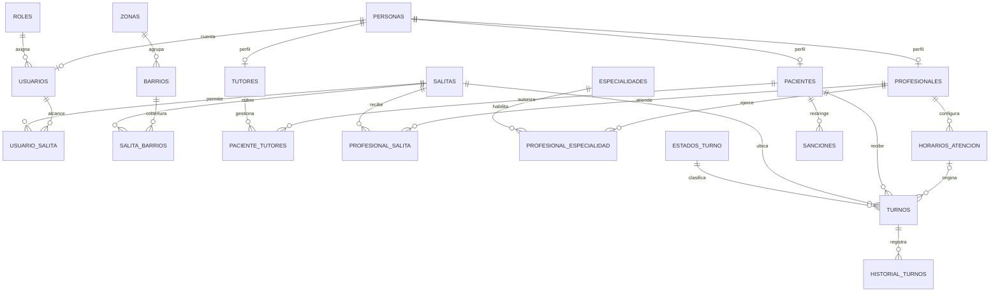

# 🗄️ Modelo de datos

[Índice](README.md) · [Diccionario SQL](DICCIONARIO_SQL.md) · [Migraciones](MIGRACIONES.md)

PostgreSQL alojado en Supabase conserva datos y restricciones. La API administra su propia autenticación; el modelo de usuarios de CORA no debe confundirse con Supabase Auth.

## Relaciones principales

El diagrama resume relaciones estructurales; no enumera todas las columnas ni representa los permisos de cada actor.

## Familias de tablas

| Familia | Tablas y propósito |
| --- | --- |
| Identidad y acceso | `personas`, `usuarios`, `roles`, `permisos`, `rol_permisos`, `usuario_identidades`, `sesiones_refresh`, `tokens_recuperacion`, `tokens_verificacion_email` |
| Territorio | `zonas`, `barrios`, `salitas`, `salita_barrios`, `usuario_salita` |
| Atención y representación | `pacientes`, `tutores`, `paciente_tutores`, `paciente_tutores_historial`, `solicitudes_vinculacion` |
| Oferta | `especialidades`, `profesionales`, `profesional_especialidad`, `profesional_salita`, `horarios_atencion` |
| Agenda | `bloqueos_agenda`, `cierres_calendario`, `calendario_sincronizacion`, `estados_turno`, `turnos`, `historial_turnos`, `sanciones` |
| Comunicación | `notificaciones`, `notificacion_envios` |
| Publicaciones | `categorias_publicas`, `noticias_publicas` |
| Transversales | `configuracion`, `auditoria` |

## Identidad y relaciones

`personas` centraliza identidad; `usuarios` representa la cuenta. Pacientes, tutores y profesionales referencian personas. Un paciente puede existir sin cuenta de acceso. El usuario que realiza una reserva puede ser distinto del paciente beneficiario.

Las tablas de asociación contienen estado y, cuando corresponde, vigencia. No basta con que exista la FK para concluir que una asociación habilita una operación en una fecha. En particular, la PK profesional/salita admite una fila por par, no varios períodos independientes.

## Integridad de agenda

Los timestamps del turno se interpretan como instantes; su rango generado utiliza límites `[)`. Las exclusiones GiST impiden solapamientos de profesional y paciente para turnos que ocupan agenda. Los estados determinan ocupación y restricciones de duplicación.

Los horarios tienen día ISO (1–7), franja válida, duración entre 5 y 240 minutos, cupo opcional positivo y vigencia. Los bloqueos tienen salita y fecha, con profesional y especialidad opcionales para delimitar alcance. Los cierres institucionales amplían el bloqueo a períodos y ámbitos definidos por su modelo.

Los triggers validan reglas al escribir, y las RPC agrupan operaciones que necesitan atomicidad. El bloqueo global de agenda y la versión de los turnos se explican en [concurrencia](CONCURRENCIA_AGENDA.md).

## Evolución y lectura del esquema

El archivo base es un reinicio destructivo de desarrollo. Las migraciones posteriores agregan tablas, columnas, índices y reemplazan funciones; leer únicamente el archivo base ofrece una visión incompleta. El [diccionario](DICCIONARIO_SQL.md) reproduce declaraciones por origen para conservar tipos, nulabilidad, defaults y restricciones sin inventar el estado de una base remota.

Los indicadores de baja lógica conservan información histórica. No aplicar borrados físicos masivos para retirar recursos de la oferta. Las políticas de retención y respaldo del entorno deben definirse institucionalmente; este repositorio no demuestra que exista una política operativa aplicada.
