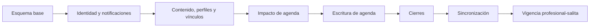

# 🧱 Migraciones de PostgreSQL

[Índice](README.md) · [Modelo](BASE_DE_DATOS.md) · [Instalación](INSTALACION_Y_OPERACION.md)

## Base y actualización incremental

[SAPS_Turno_BBDD3_FINAL.sql](../backend/src/BBDD/SAPS_Turno_BBDD3_FINAL.sql) es un script de reinicio completo para desarrollo: ejecuta `DROP TABLE ... CASCADE` y elimina datos antes de recrear objetos. No es una actualización segura de una base con información que se deba conservar.

Las migraciones incrementales están en [BBDD](../backend/src/BBDD). El orden siguiente conserva las dependencias explícitas; dentro de una misma fecha el nombre alfabético no determina el orden correcto.

| Paso | Archivo | Evolución |
| --- | --- | --- |
| 1 | `20260926_email_verification_attempts.sql` | Intentos de verificación de correo |
| 2 | `20260929_password_recovery_codes.sql` | Recuperación por códigos |
| 3 | `20260929_patient_email_change.sql` | Cambio de correo del paciente |
| 4 | `20261006_unique_person_email.sql` | Unicidad de correo personal |
| 5 | `20261006_notificaciones_audiencia.sql` | Selección de destinatarios |
| 6 | `20261006_notificaciones_envios.sql` | Envíos y registros de entrega |
| 7 | `20261006_notificaciones_worker.sql` | Procesamiento y reclamación de trabajo |
| 8 | `20261006_notificaciones_edicion.sql` | Edición de envíos pendientes |
| 9 | `20261006_notificaciones_excluir_remitente.sql` | Exclusión del remitente |
| 10 | `20261007_contenido_publico.sql` | Categorías y noticias |
| 11 | `20261011_admin_profile.sql` | Perfil administrativo |
| 12 | `20261020_sancion_global_inasistencia.sql` | Sanción por inasistencia para todas las especialidades |
| 13 | `20261031_solicitudes_vinculacion.sql` | Solicitudes, autorización e historial de vínculos |
| 14 | `20261103_agenda_impacto.sql` | Impacto y serialización de agenda |
| 15 | `20261103_agenda_escritura.sql` | Escritura transaccional e historial |
| 16 | `20261107_cierres_calendario.sql` | Cierres institucionales |
| 17 | `20261108_argentinadatos.sql` | Sincronización, lease y cierres importados |
| 18 | `20261109_profesional_salita_vigencia.sql` | Validación de asociación vigente al reservar |

## Procedimiento operativo

1. Identificar entorno, versión del código y cambios SQL ya aplicados. La presencia del archivo local no demuestra que esté aplicado.
2. Leer el archivo completo, sus precondiciones y cualquier consulta de detección de datos incompatibles.
3. Preparar respaldo y recuperación; revisar dependencias, extensiones y permisos del ejecutor.
4. Aplicar las migraciones pendientes en el orden de dependencia, conservando registro de resultado.
5. Revisar funciones, triggers y restricciones resultantes antes de habilitar escrituras del nuevo código.
6. Verificar los flujos afectados en un entorno controlado con datos ficticios.

No reenviar ciegamente todos los scripts: algunos usan `CREATE FUNCTION` y no todos garantizan repetición idempotente. No eliminar el control que detecta datos incompatibles para forzar una migración; resolver primero la causa.

## Cambios de funciones y rollback

Una función `CREATE OR REPLACE` sustituye comportamiento anterior aun sin alterar tablas. Para comprender la validación efectiva hay que leer la última definición aplicada. La migración de vigencia reemplaza `validar_turno()` y depende de la infraestructura previa de agenda y calendario.

No existe aquí una garantía general de rollback automático. Revertir puede exigir una migración compensatoria o restaurar un respaldo; volver a ejecutar el archivo base destruiría información. Los scripts con `BEGIN`/`COMMIT` delimitan su transacción, pero no convierten una serie de archivos en una única operación atómica.

Esta documentación describe dependencias del repositorio; no certifica una aplicación de migraciones durante esta tarea.
