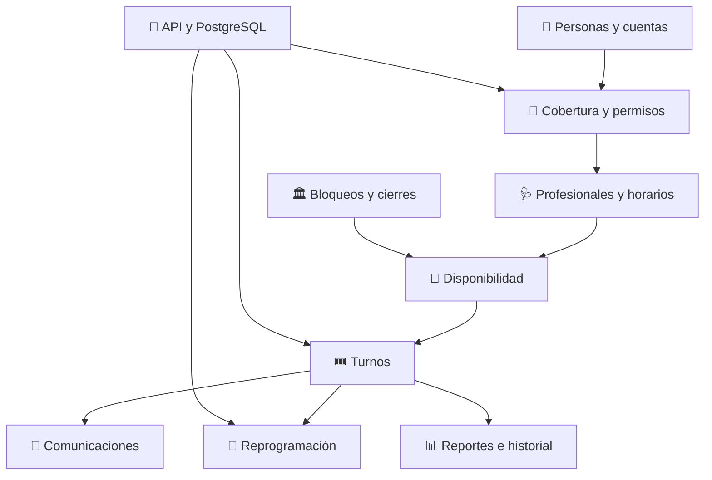

# 📚 Documentación de CORA · SAPS Turno

[← Presentación del proyecto](../README.md)

Esta biblioteca describe la implementación disponible en el repositorio: aplicación React, API Express, PostgreSQL, procesos periódicos e integraciones. Está organizada por responsabilidad para que cada cambio pueda documentarse en su módulo.

La revisión documental es estática. Un archivo de migración no prueba que esté aplicado en una base externa; un comando de verificación documentado no significa que se haya ejecutado. Los informes de implementaciones anteriores conservan su contexto histórico.

## 🧭 Recorridos de lectura

| Necesidad | Recorrido |
| --- | --- |
| Entender el producto | [Manual por rol](MANUAL_USUARIO.md) → [reglas de turnos](TURNOS_Y_DISPONIBILIDAD.md) |
| Incorporarse al desarrollo | [Arquitectura](ARQUITECTURA.md) → [backend](BACKEND.md) → [frontend](FRONTEND.md) → [inventario](INVENTARIO_CODIGO.md) |
| Preparar un entorno | [Instalación y operación](INSTALACION_Y_OPERACION.md) → [migraciones](MIGRACIONES.md) |
| Integrar un cliente | [Contrato HTTP](API.md) → [inventario de rutas](API_RUTAS.md) → [seguridad](SEGURIDAD_Y_ACCESO.md) |
| Comprender datos | [Modelo relacional](BASE_DE_DATOS.md) → [diccionario SQL](DICCIONARIO_SQL.md) |
| Mantener el proyecto | [Mantenimiento](MANTENIMIENTO.md) → documentación del módulo afectado |

## 🗂️ Catálogo por área

| Área | Documentos |
| --- | --- |
| Arquitectura y código | [Arquitectura](ARQUITECTURA.md), [Backend](BACKEND.md), [Frontend](FRONTEND.md), [Inventario de código](INVENTARIO_CODIGO.md) |
| Datos y contratos | [Base de datos](BASE_DE_DATOS.md), [Diccionario SQL](DICCIONARIO_SQL.md), [Migraciones](MIGRACIONES.md), [API](API.md), [Rutas declaradas](API_RUTAS.md) |
| Identidad y protección | [Autenticación](AUTENTICACION.md), [Seguridad y acceso](SEGURIDAD_Y_ACCESO.md), [Privacidad del navegador](PRIVACIDAD_NAVEGADOR.md) |
| Pacientes | [Autogestión](PACIENTE_AUTOGESTION.md), [Personas a cargo](personas-a-cargo.md), [Manual por rol](MANUAL_USUARIO.md) |
| Recursos | [Salitas, cobertura, profesionales y configuración](RECURSOS_Y_CONFIGURACION.md) |
| Turnos y agenda | [Reservas y disponibilidad](TURNOS_Y_DISPONIBILIDAD.md), [Vigencia profesional-salita](VIGENCIA_PROFESIONAL_SALITA.md), [Concurrencia](CONCURRENCIA_AGENDA.md) |
| Reprogramación | [Asistencia de agenda](agenda-reprogramacion-asistida.md), [Ausencias y operación rápida](ausencias-reprogramacion-rapida.md) |
| Calendario institucional | [Feriados y cierres](feriados-cierres-institucionales.md), [ArgentinaDatos](argentinadatos-calendario.md) |
| Comunicación y contenido | [Notificaciones](NOTIFICACIONES.md), [Contenido público](CONTENIDO_PUBLICO.md), [Integraciones y tiempo real](INTEGRACIONES.md) |
| Información de gestión | [Reportes y auditoría](REPORTES_Y_AUDITORIA.md), [Dashboard general](DASHBOARD_SUPER_ADMIN.md) |
| Asistente | [CORA](CHATBOT.md), [Verificación histórica](CHATBOT_VERIFICACION.md) |
| Operación | [Instalación y operación](INSTALACION_Y_OPERACION.md), [Mantenimiento](MANTENIMIENTO.md) |

## 🧩 Mapa del sistema

## Convenciones

- Los diagramas Mermaid muestran relaciones o secuencias de la implementación; no sustituyen las restricciones SQL ni los permisos de las rutas.
- Los enlaces a código son relativos al repositorio y no requieren un editor específico.
- El catálogo de rutas documenta declaraciones estáticas, no una especificación OpenAPI ejecutable.
- El diccionario identifica DDL de creación y evoluciones por migración; no se presenta como introspección de una base desplegada.
- Una limitación indicada como pendiente no es una funcionalidad implementada.

## Glosario

| Término | Significado |
| --- | --- |
| Persona | Identidad y datos personales; puede tener distintos perfiles. |
| Usuario | Cuenta que autentica y ejecuta una operación. |
| Paciente | Persona que recibe atención; puede no tener cuenta propia. |
| Tutor/responsable | Persona vinculada mediante una autorización; parentesco no equivale a permiso. |
| Salita | Establecimiento de atención primaria. |
| Vigente | Estado habilitado e intervalo válido para la fecha evaluada. |
| Horario | Configuración semanal de una franja de atención. |
| Slot | Intervalo calculado a partir de un horario; no es una reserva persistida. |
| Afectado | Turno incompatible con un cambio de agenda o cierre. |
| RPC | Función PostgreSQL invocada a través de Supabase/PostgREST. |
| Lease | Derecho temporal de ejecución identificado por un token. |

