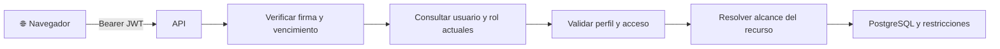

# 🔐 Seguridad y autorización

[Índice](README.md) · [Autenticación](AUTENTICACION.md) · [Privacidad](PRIVACIDAD_NAVEGADOR.md)

## Límites de confianza

Los controles de React mejoran la navegación, pero no conceden permisos. El servidor autentica y vuelve a resolver el alcance. Los identificadores enviados por el cliente no prueban propiedad ni asignación.

## Modelo de autorización

Las rutas declaran los roles permitidos mediante middleware (`requireRole`) y los servicios/middlewares de alcance verifican la operación y la relación con el recurso. La autorización no se deriva de permisos configurables por usuario: aunque el esquema SQL contiene catálogos de permisos y asociaciones rol-permiso, el middleware de rutas comprueba el código de rol y aplica controles específicos. No interpretar la existencia de esas tablas como un motor dinámico de permisos.

## Roles y alcance

| Rol | Criterio general |
| --- | --- |
| SUPER_ADMIN | Administración global, con controles propios de cada operación |
| ADMIN_SALITA | Salitas de asignaciones vigentes de `usuario_salita` |
| RECEPCION | Alcance territorial asignado y operaciones expresamente habilitadas por ruta; la interfaz ofrece actualmente acceso limitado a bloqueos de agenda |
| PROFESIONAL | Identidad profesional asociada y agenda propia |
| PACIENTE | Identidad propia o relaciones delegadas aprobadas con permisos válidos |

La asignación administrativa se evalúa para el día actual; la habilitación de atención profesional se evalúa para el día de la consulta. No intercambiar ambas fechas.

## Credenciales y sesiones

Las contraseñas se procesan con Argon2. Los JWT de acceso se firman y verifican con JOSE. Las sesiones de renovación guardan el token de forma hasheada y lo rotan; existen expiración y revocación. El acceso HTTP consulta que usuario y rol continúen activos. El acceso administrativo exige correo verificado y perfil completo; las rutas destinadas a completar perfil tienen un tratamiento específico.

El frontend almacena tokens y usuario en `localStorage`. Este mecanismo implica exposición ante JavaScript ejecutado en el mismo origen: evitar HTML no confiable y revisar dependencias. No describir las sesiones como cookies HttpOnly.

La verificación con Google comprueba el token contra el cliente configurado. La gestión de recuperación, verificación y cambio de correo se desarrolla en [autenticación](AUTENTICACION.md).

## HTTP y canales secundarios

Express incorpora Helmet y límites de cuerpo. La configuración actual de CORS refleja el origen (`origin: true`) y permite credenciales; `FRONTEND_URL` no es por sí mismo una lista restrictiva de CORS. CORS tampoco sustituye autenticación.

Socket.IO verifica JWT, usuario y rol activos, y resuelve el profesional. Su conexión no debe describirse como una ejecución idéntica de todos los middlewares HTTP. Las consultas posteriores de agenda siguen sujetas a la autorización de la API.

Los límites del chatbot se mantienen por proceso; varias réplicas no comparten automáticamente esos contadores. Las claves de Supabase, JWT, SMTP y Gemini permanecen del lado del servidor. Las variables `VITE_*` se incorporan al cliente y no son lugar para secretos.

## Datos y trazabilidad

Los permisos de representación se basan en relaciones aprobadas, no solamente en parentesco. Los reportes nominales y los destinatarios de notificaciones requieren resolver alcance. La auditoría registra operaciones, pero no equivale a una certificación legal ni a un registro inmutable externo.

El aviso de privacidad del navegador registra reconocimiento local; no es un consentimiento clínico ni una prueba de aceptación firmada. La política institucional requiere su propia validación.

Fuentes: [middlewares](../backend/src/middlewares), [sesiones y servicios](../backend/src/services), [configuración Express](../backend/src/app.ts), [frontend](FRONTEND.md). No se ejecutó una auditoría de penetración como parte de esta documentación.
